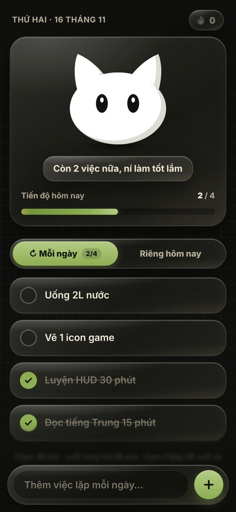

<div align="center">


# Figgy To-do

**To-do mỗi ngày cùng bé mèo Figgy, tối ưu cho iPhone**

[**▶ Mở bản demo**](https://thanhdesignn-sketch.github.io/figgy-todo/)

</div>

---

<p align="center">
  
</p>

## Giới thiệu

Figgy To-do là web app to-do hằng ngày, làm để thêm ra màn hình chính iPhone và dùng như một app thật. Nhân vật chính là **Figgy**, linh vật mèo của InsFig. Figgy phản ứng theo từng việc ní thêm, tick hay xoá. Giao diện dark mode tông matcha latte theo phong cách liquid glass.

Không cần tài khoản, không có server: danh sách việc lưu ngay trên máy mỗi người.

## Tính năng

- **Hai tab việc:** *Mỗi ngày* (tự bỏ tick khi qua ngày mới) và *Riêng hôm nay* (xong thì tự dọn, chưa xong thì dời sang hôm sau)
- **Figgy biết phản ứng:** chớp mắt, vẫy tai, liếc theo chỗ ní chạm; nhảy lên khi thêm việc; mắt long lanh khi tick xong; nhắm mắt cười khi xong hết; chạm vào để vuốt ve
- **Chuỗi lửa kiểu TikTok:** xong hết việc trong ngày để giữ lửa, lửa bùng lên mỗi khi chuỗi tăng
- **Thanh tiến độ sóng nhiệt:** đoạn vừa hoàn thành ửng cam rồi nguội dần về matcha
- **Vuốt để xoá kiểu iOS:** có quán tính và lò xo; vuốt dài để xoá nhanh; có nút *Hoàn tác*
- **Badge trên icon:** hiện số việc còn lại trên icon app (iOS 16.4+)
- **Chạy offline** sau lần mở đầu tiên
- Tự giảm chuyển động khi bật *Giảm chuyển động* trên máy

## Cài lên iPhone

1. Mở [link demo](https://thanhdesignn-sketch.github.io/figgy-todo/) bằng **Safari**
2. Bấm nút **Share** (ô vuông mũi tên lên) → **Add to Home Screen** → bật **Open as Web App** nếu có → **Add**
3. Mở app từ icon Figgy, bấm **Bật badge** → **Allow**

App ngoài màn hình chính tự cập nhật lên bản mới mỗi khi mở có mạng. Nếu vẫn thấy bản cũ, tắt hẳn app trong màn hình đa nhiệm rồi mở lại.

> Lưu ý: dữ liệu nằm trên máy. Mở trong Safari và mở từ icon là hai danh sách riêng; xoá icon hoặc đổi máy sẽ mất danh sách.

## Công nghệ

Một file `index.html` thuần HTML/CSS/JS, không framework, không bước build.

| File | Vai trò |
|---|---|
| `index.html` | Toàn bộ giao diện, animation và logic |
| `manifest.json` | Khai báo web app (tên, icon, chế độ toàn màn hình) |
| `sw.js` | Service worker: cache để chạy offline, luôn ưu tiên bản mới khi có mạng |
| `favicon.svg`, `icon-*.png`, `apple-touch-icon.png` | Icon Figgy |

- Lưu dữ liệu: `localStorage`
- Badge: [Badging API](https://developer.mozilla.org/en-US/docs/Web/API/Badging_API) (`navigator.setAppBadge`)
- Animation: SVG + spring physics tự viết bằng `requestAnimationFrame`, Web Animations API, kỹ thuật FLIP cho việc đổi chỗ
- Hosting: GitHub Pages

## Chạy thử trên máy

```bash
git clone https://github.com/thanhdesignn-sketch/figgy-todo.git
cd figgy-todo
python3 -m http.server 8000
# mở http://localhost:8000
```

---

<p align="center">Made by <b>Thanh.Ng</b> · Figgy © Thanh.Ng</p>
